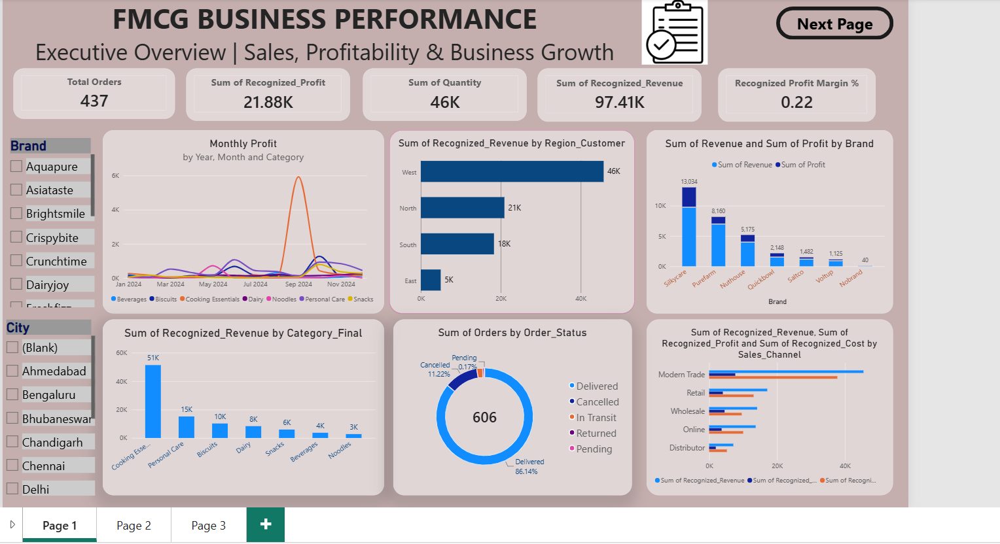
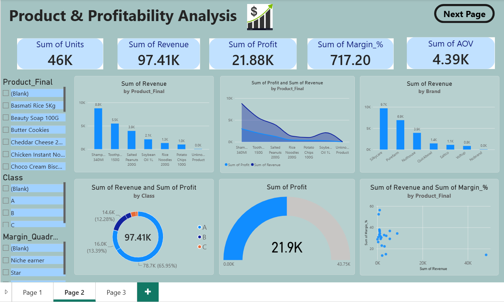

# FMCG Sales Performance & Business Intelligence Analysis

## Table of Contents

- [1. Project Overview](#1-project-overview)
- [2. Business Problem](#2-business-problem)
- [3. Project Objectives](#3-project-objectives)
- [4. Dataset Description](#4-dataset-description)
- [5. Tools and Technologies](#5-tools-and-technologies)
- [6. Project Workflow](#6-project-workflow)
- [7. Key Performance Indicators (KPIs)](#7-key-performance-indicators-kpis)
- [8. Key Business Insights](#8-key-business-insights)
- [9. Power BI Dashboard](#9-power-bi-dashboard)
  - [Dashboard Page 1: Executive Overview](#dashboard-page-1-fmcg-business-performance)
  - [Dashboard Page 2: Product & Profitability](#dashboard-page-2-product--profitability-analysis)
- [10. Business Recommendations](#10-business-recommendations)
- [11. Python Data Visualizations](#11-python-data-visualizations)
- [12. Project Structure](#12-project-structure)
- [13. How to Run This Project](#13-how-to-run-this-project)
- [14. Requirements](#14-requirements)
- [15. Conclusion](#15-conclusion)
- [16. Author](#16-author)
- [17. Contact](#17-contact)

---

## 1. Project Overview

This project focuses on analyzing FMCG (Fast-Moving Consumer Goods) sales data to evaluate business performance, identify sales trends, understand customer purchasing patterns, and generate actionable business insights.

The project combines Python-based data analysis with Power BI dashboard development to transform raw sales data into meaningful business information.

The analysis covers data cleaning, standardization, exploratory data analysis (EDA), KPI development, product profitability, regional performance, and interactive business intelligence reporting.

**Project Goal:** To demonstrate how data analytics and business intelligence tools can support strategic and operational decision-making in the FMCG industry.

---

## 2. Business Problem

FMCG companies generate large volumes of sales data across different regions, products, brands, customers, and sales channels.

Without proper analysis, businesses may face difficulties in:

- Identifying high-performing products and brands.
- Evaluating regional sales performance.
- Understanding sales channel contribution.
- Monitoring product profitability.
- Identifying customer purchasing patterns.
- Tracking product returns and order status.
- Making informed business decisions.

This project addresses these challenges through Python-based analysis and interactive Power BI reporting.

---

## 3. Project Objectives

- Clean and standardize raw FMCG sales data.
- Identify and handle missing and invalid values.
- Remove duplicate records.
- Perform exploratory data analysis.
- Calculate important business KPIs.
- Analyze regional and sales channel performance.
- Evaluate product, brand, and category performance.
- Analyze product profitability and profit margins.
- Monitor order status and product returns.
- Develop an interactive Power BI dashboard.
- Generate data-driven business recommendations.

---

## 4. Dataset Description

The cleaned dataset used for the Python analysis contains **606 rows and 25 columns**.

Important dataset fields include:

| Column | Description |
|---|---|
| Order_ID | Unique order identification |
| Order_Date | Date of customer order |
| Customer_ID | Customer identification |
| Region | Sales region |
| City | Customer city |
| Product_ID | Product identification |
| Product_Name | Product name |
| Category | Product category |
| Brand | Product brand |
| Quantity | Number of units ordered |
| Unit_Price | Price per unit |
| Discount_Pct | Discount percentage |
| Sales_Channel | Channel used for sales |
| Payment_Method | Payment method |
| Returned | Return status |
| Order_Status | Order status |
| Sales_Amount | Sales amount |
| Cost_Amount | Product cost |
| Profit | Profit amount |

---

## 5. Tools and Technologies

| Tool | Purpose |
|---|---|
| Python | Data analysis |
| Pandas | Data manipulation and cleaning |
| NumPy | Numerical operations |
| Matplotlib | Data visualization |
| Seaborn | Statistical visualization |
| Microsoft Excel | Dataset inspection |
| Power BI | Interactive dashboard development |
| DAX | KPI and measure calculations |
| Jupyter Notebook | Interactive analysis |
| VS Code | Development environment |
| Git & GitHub | Version control and project hosting |

---

## 6. Project Workflow

### Step 1: Data Understanding

- Imported the FMCG dataset.
- Inspected dataset structure and dimensions.
- Checked data types.
- Identified missing and duplicate values.

### Step 2: Data Cleaning and Standardization

- Removed 8 exact duplicate records.
- Identified 48 invalid quantity records.
- Identified 39 invalid discount records.
- Identified 4 invalid return values.
- Identified 5 invalid order dates.
- Checked missing values and inconsistent data.
- Standardized relevant columns and values.

### Step 3: Exploratory Data Analysis (EDA)

- Analyzed numerical and categorical variables.
- Evaluated regional sales performance.
- Compared sales channels.
- Analyzed customer types.
- Evaluated product and brand performance.
- Investigated product return patterns.

### Step 4: KPI Analysis

Calculated important business performance indicators, including:

- Revenue
- Profit
- Profit Margin
- Total Orders
- Total Quantity
- Average Order Value (AOV)

### Step 5: Power BI Dashboard Development

- Imported the sales dataset into Power BI.
- Developed DAX measures.
- Created business performance KPIs.
- Designed interactive visualizations.
- Added slicers and filters.
- Developed multiple dashboard pages.
- Organized the dashboard for business reporting.

### Step 6: Business Insights and Recommendations

Identified important business trends and developed recommendations based on the analysis.

---

## 7. Key Performance Indicators (KPIs)

The following KPI values are displayed in the Power BI dashboard:

| KPI | Dashboard Value |
|---|---:|
| Total Orders | 437 |
| Recognized Revenue | 97.41K |
| Recognized Profit | 21.88K |
| Total Quantity | 46K |
| Recognized Profit Margin | 0.22 |
| Average Order Value (AOV) | 4.39K |

**Note:** The profit margin card displays 0.22, which represents approximately 22% if the underlying measure is stored as a decimal. Confirm the formatting in Power BI before publication.

---

## 8. Key Business Insights

### Regional Performance

The dashboard indicates:

- West is the leading region in recognized revenue.
- North is the second-highest revenue-generating region.
- South contributes a moderate level of revenue.
- East records the lowest revenue contribution.

**Business Insight:** Investigate the factors behind West's strong performance and identify opportunities to improve sales in East.

### Brand Performance

The dashboard compares revenue and profit across different brands.

- Skycare is the leading brand in the displayed revenue comparison.
- Purefarm and Nuthouse also show significant contributions.
- Some brands contribute comparatively lower revenue.

**Business Insight:** Evaluate the performance of leading brands and investigate growth opportunities for lower-performing brands.

### Category Performance

The category revenue visualization indicates:

- Cooking Essentials generates the highest revenue.
- Personal Care is another important revenue contributor.
- Biscuits and Dairy also contribute to overall sales.
- Snacks, Beverages, and Noodles have comparatively lower revenue.

**Business Insight:** Use category-level performance to support inventory planning and product portfolio decisions.

### Order Status Analysis

The order status visualization shows:

- Delivered orders account for approximately 86.14%.
- Cancelled orders account for approximately 11.22%.
- Other order statuses contribute smaller proportions.

**Business Insight:** Investigate cancellation reasons and identify opportunities to improve order fulfillment.

### Product Profitability

The second dashboard page evaluates product revenue and profit.

- Shampoo 340ML is the leading product in the displayed revenue comparison.
- Toothpaste 150G and Salted Peanuts 200G are also important contributors.
- Product-level revenue and profit comparisons help identify differences in financial performance.

**Business Insight:** Product-level profitability analysis can support pricing, promotion, and product portfolio decisions.

---

## 9. Power BI Dashboard

The Power BI dashboard contains multiple pages designed to provide an overview of FMCG business performance.

### Dashboard Page 1: FMCG Business Performance

This page presents an executive overview of sales, profitability, and business growth.

**Key Visualizations:**

- Total Orders KPI
- Recognized Profit KPI
- Total Quantity KPI
- Recognized Revenue KPI
- Recognized Profit Margin KPI
- Monthly Profit Trend
- Regional Revenue Analysis
- Brand Revenue and Profit Comparison
- Category Revenue Analysis
- Order Status Distribution
- Sales Channel Performance

#### Dashboard Preview



---

### Dashboard Page 2: Product & Profitability Analysis

This page focuses on product-level performance and profitability.

**Key Visualizations:**

- Total Units KPI
- Total Revenue KPI
- Total Profit KPI
- Margin Percentage KPI
- Average Order Value KPI
- Product Revenue Comparison
- Product Profit and Revenue Analysis
- Brand Revenue Analysis
- Class-wise Revenue and Profit
- Overall Profit Gauge
- Product Revenue and Margin Relationship

#### Dashboard Preview



---

## 10. Business Recommendations

Based on the analysis, the following recommendations can support business decision-making:

1. **Regional Growth:** Investigate opportunities to improve revenue contribution in the East region.
2. **Brand Strategy:** Maintain the performance of leading brands while developing strategies for lower-performing brands.
3. **Category Management:** Use category-level sales performance to improve inventory and product portfolio planning.
4. **Order Management:** Investigate cancellation reasons and improve order fulfillment.
5. **Product Profitability:** Evaluate product-level revenue and profit before making pricing and promotional decisions.
6. **Sales Channel Optimization:** Compare revenue and profitability across sales channels to identify improvement opportunities.
7. **Performance Monitoring:** Use the Power BI dashboard to monitor important business KPIs regularly.

---

## 11. Python Data Visualizations

The Python analysis includes:

- Regional revenue performance.
- Sales channel revenue and profit.
- Customer type revenue contribution.
- City-level sales performance.
- Brand performance.
- Product and category performance.
- Regional return rate analysis.
- Financial KPI analysis.

---

## 12. Project Structure

```text
FMCG-Sales-Performance-Analysis/
│
├── README.md
│
├── data/
│   ├── raw/
│   │   └── FMCG_Raw_Data.xlsx
│   │
│   └── processed/
│       └── FMCG_Cleaned_Data.xlsx
│
├── notebooks/
│   ├── 01_Data_Cleaning_Standardization.ipynb
│   └── 02_Exploratory_Data_Analysis.ipynb
│
├── powerbi/
│   └── FMCG_Sales_Dashboard.pbix
│
├── visualizations/
│   ├── FMCG_Executive_Overview.png
│   └── FMCG_Product_Profitability.png
│
└── requirements.txt
```

---

## 13. How to Run This Project

### Step 1: Clone the Repository

```bash
git clone YOUR_GITHUB_REPOSITORY_LINK
```

### Step 2: Open the Project Folder

```bash
cd FMCG-Sales-Performance-Analysis
```

### Step 3: Install Required Libraries

```bash
pip install -r requirements.txt
```

### Step 4: Launch Jupyter Notebook

```bash
jupyter notebook
```

### Step 5: Run the Notebooks

Run the notebooks in the following order:

1. `01_Data_Cleaning_Standardization.ipynb`
2. `02_Exploratory_Data_Analysis.ipynb`

### Step 6: Explore the Power BI Dashboard

Open the following file using Microsoft Power BI Desktop:

`powerbi/FMCG_Sales_Dashboard.pbix`

---

## 14. Requirements

Create a file named `requirements.txt` and add:

```text
pandas
numpy
matplotlib
seaborn
openpyxl
jupyter
```

---

## 15. Conclusion

This FMCG Sales Performance Analysis project demonstrates the practical application of Python-based data analytics and Power BI in business decision-making.

Through data cleaning, exploratory data analysis, KPI development, visualization, and interactive dashboard development, the project provides insights into regional sales, brand performance, category contribution, product profitability, and order management.

The project demonstrates how data analytics can transform raw business data into meaningful insights that support strategic planning and operational improvement.

---

**Project Category:** Data Analytics | FMCG | Business Intelligence

**Technical Skills:** Python, Pandas, NumPy, Matplotlib, Seaborn, Power BI, DAX, Excel, Git & GitHub

**Analytical Skills:** Data Cleaning, EDA, KPI Analysis, Profitability Analysis, Business Insights, Data Visualization, Data Storytelling

## 16. Author

**Supto Saha** | Food Engineering Student & Aspiring Data Analyst

---

## 17. Contact

- [LinkedIn](https://www.linkedin.com/in/supto-saha-732a023aa)
- [GitHub](https://github.com/SuptoSahaDA)
- Email: [suptosaha088@gmail.com](mailto:suptosaha088@gmail.com)
